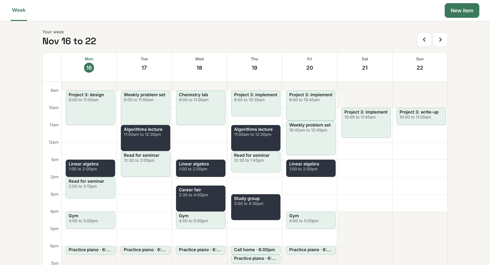

# MyCal

A personal weekly planner: I describe what I need to do, and a constraint solver places it on my week.



## What it does

- **Fixed and flexible items.** A lecture is fixed at an exact time. A flexible item says how long it takes and roughly when ("any of these days", "before Friday 5pm"), and the solver picks the time.
- **Splits long work.** Multi-hour work is cut into sessions of a set maximum length, optionally on different days.
- **Balances the week.** It keeps the fullest day as light as it can and spreads an item's sessions out.
- **Soft rules.** Preferred or avoided times of day, and rest days between sessions (say, for the gym).
- **Re-plans on changes.** Adding, editing or deleting an item re-plans the weeks it touches. A change that doesn't fit is refused with the reason, and nothing changes.

## How the solver works

The solver is a pure function: items, blocks, work frames and constraints in, placements out. The default engine uses OR-Tools CP-SAT. A simpler backtracking engine sits behind the same `solve()` interface.

**Model.** Time is cut into slots (15 minutes by default). Each session of work gets an integer start variable whose domain is its allowed start slots, plus an interval variable, and one NoOverlap constraint covers all the intervals. Fixed events don't move, so instead of adding them as intervals, starts that would overlap them are removed from the domains up front.

**Day booleans.** Each session also gets one boolean per local day it could start on, with exactly one true, linked to the start through `OnlyEnforceIf`. These express "at most one session of this item per day" and daily limits, and keep the score linear.

**Score.** The objective has six tiers, minimized in strict priority order:

1. Stability: sessions moved away from their current start
2. Spread: extra sessions of the same item on one day
3. Preferences: weighted soft rules (time preferences, rest days)
4. Earlier week: work goes in the earliest week with room
5. Balance: the fullest day, as a share of its work-frame time
6. Earlier in the frame: sessions start early in their work frame

`tier_weights` gives each tier a weight greater than the most all lower tiers can add up to, plus the stopping slack. So no gain in a lower tier can make up for being worse in a higher one.

**Deterministic stopping.** CP-SAT runs with one worker and a fixed seed. It stops when it proves its plan is within a small gap of the best (`absolute_gap_limit`). Because of the weights, only tier 6 can come out worse, by a bounded number of slots. A deterministic work limit (`max_deterministic_time`) is the backstop. There is no wall-clock limit, so the same input and OR-Tools version (pinned in `uv.lock`) give the same plan on any machine.

The details are in the comments of [`solver/src/mycal/cp_sat.py`](solver/src/mycal/cp_sat.py), and the full spec is in [`docs/PRD.md`](docs/PRD.md).

## Stack

| Part | Choice |
| --- | --- |
| Solver | Python 3.12, OR-Tools CP-SAT, pytest, managed with uv |
| API | FastAPI |
| Storage | SQLite through Python's built-in `sqlite3` |
| Web | React, TypeScript, Vite, Vitest |

## Run it locally

You need [uv](https://docs.astral.sh/uv/) and Node.js. Install uv on Windows with `winget install --id=astral-sh.uv -e`, or on a Mac with `curl -LsSf https://astral.sh/uv/install.sh | sh`.

The sample week, [`solver/examples/week.toml`](solver/examples/week.toml), is made-up data for the week of November 16, 2026. It goes into its own database, `solver/data/sample.db` (gitignored).

**Mac (zsh).** In one terminal, from `solver/`:

```zsh
uv sync
uv run mycal-import examples/week.toml --db data/sample.db
MYCAL_DB=data/sample.db uv run mycal-api
```

**Windows (PowerShell).** In one terminal, from `solver/`:

```powershell
uv sync
uv run mycal-import examples/week.toml --db data/sample.db
$env:MYCAL_DB = "data/sample.db"; uv run mycal-api
```

Then in a second terminal, from `web/`:

```
npm install
npm run dev
```

Open http://localhost:5173/?week=2026-11-16.

The planner only places new work after the current time, so once that week is in the past, the page has little left to plan. To see the solver's plan for the sample week at any time, without the database or the page, run this from `solver/`:

```
uv run mycal-demo examples/week.toml
```

Work frames and rules come from the week file for now. Edit `examples/week.toml` (its comments explain each field) and run `mycal-demo` again to try your own.

## Tests

From `solver/`:

```
uv run pytest
```

From `web/`:

```
npm test
npm run lint
npm run build
```

`npm run build` also type-checks.

## Status

Built in milestones, each usable before the next starts (see Milestones in the [PRD](docs/PRD.md)):

1. Solver package. Done.
2. Read-only week view. Done.
3. Storage, adding and deleting items. Done.
4. Editing items. Done.
5. Work frames and rules in the app. Next. Until then they are set in week files.
6. Repeating items (weekly classes, habits) in the app.
7. Check-ins: Yes / Partly / No when a session ends, then reschedule, catch up, skip or ask.

## How I built it

I designed MyCal with Claude, starting with the [PRD](docs/PRD.md) and a prototype, and built it with Claude Code. [`CLAUDE.md`](CLAUDE.md) holds the rules every session follows, such as keeping the solver a pure function and storing every time in UTC, and [`web/DESIGN.md`](web/DESIGN.md) holds the design spec for the page.
